  
  
I design interfaces and then build them myself, so nothing gets lost between the mockup and the merge.

  

    
    
    
    
  

<table>
  <tr>
    <th align="left">If you're hiring a designer</th>
    <th align="left">If you want to build something</th>
    <th align="left">If you're just looking around</th>
  </tr>
  <tr>
    <td>See the case studies on <a href="https://www.behance.net/biragirma">Behance</a></td>
    <td><a href="mailto:biragirma4@gmail.com">Send me the idea</a>, even a rough one</td>
    <td>Open the <a href="#layers">layers</a> below, one of them is hidden</td>
  </tr>
</table>

 

  <a href="https://lockin-beige-three.vercel.app/dashboard"><b>Open Lockin</b></a>
  &nbsp;&nbsp;|&nbsp;&nbsp;
  <a href="https://github.com/Birabg?tab=repositories">Browse all my repos</a>

 

<a href="https://github.com/Birabg">
<picture>
<source media="(prefers-color-scheme: dark)" srcset="https://streak-stats.demolab.com?user=Birabg&hide_border=true&background=0E1330&stroke=1E2650&ring=0D99FF&fire=0D99FF&currStreakLabel=0D99FF&sideLabels=B4BCE0&currStreakNum=FFFFFF&sideNums=FFFFFF&dates=7F89B8"/>
<source media="(prefers-color-scheme: light)" srcset="https://streak-stats.demolab.com?user=Birabg&hide_border=true&background=FFFFFF&stroke=D0D7DE&ring=0D99FF&fire=0D99FF&currStreakLabel=0D99FF&sideLabels=57606A&currStreakNum=1F2328&sideNums=1F2328&dates=8C959F"/>

</picture>
</a>
 
Shipping something, most days.

## Layers

<b>▢ About</b>&nbsp;&nbsp;who's behind the pixels

Hey, I'm <b>Bira</b>, a design engineer from Ethiopia and a 4th-year Computer Science &amp; Engineering student at ASTU.

I care about the whole path of a product: figuring out what the problem actually is, designing the experience around real people, and then writing the code that makes it work. Most of what I make starts as a frame and ends as a deploy.

<b>▢ Process</b>&nbsp;&nbsp;how an idea becomes a product

 

<b>▢ Now</b>&nbsp;&nbsp;what I'm working on

<pre>
$ bira --status

studying      4th year, CS&amp;E at ASTU
learning      software architecture and system design
sharpening    frontend and backend engineering
exploring     product design and the UX decisions behind it
building      Lockin, and whatever idea won't leave me alone
</pre>

<b>▢ Activity</b>&nbsp;&nbsp;what my GitHub has been up to

 

<picture>
<source media="(prefers-color-scheme: dark)" srcset="https://github-readme-stats.vercel.app/api?username=Birabg&show_icons=true&hide_border=true&bg_color=0E1330&title_color=0D99FF&text_color=B4BCE0&icon_color=0D99FF&rank_icon=github&include_all_commits=true"/>
<source media="(prefers-color-scheme: light)" srcset="https://github-readme-stats.vercel.app/api?username=Birabg&show_icons=true&hide_border=true&bg_color=FFFFFF&title_color=0D99FF&text_color=424A53&icon_color=0D99FF&rank_icon=github&include_all_commits=true"/>

</picture>
<picture>
<source media="(prefers-color-scheme: dark)" srcset="https://github-readme-stats.vercel.app/api/top-langs/?username=Birabg&layout=compact&hide_border=true&bg_color=0E1330&title_color=0D99FF&text_color=B4BCE0&langs_count=8"/>
<source media="(prefers-color-scheme: light)" srcset="https://github-readme-stats.vercel.app/api/top-langs/?username=Birabg&layout=compact&hide_border=true&bg_color=FFFFFF&title_color=0D99FF&text_color=424A53&langs_count=8"/>

</picture>

  

<picture>
<source media="(prefers-color-scheme: dark)" srcset="https://github-readme-activity-graph.vercel.app/graph?username=Birabg&bg_color=0E1330&color=B4BCE0&line=0D99FF&point=FFFFFF&area=true&area_color=0D99FF&hide_border=true&radius=12&custom_title=Contribution%20Activity"/>
<source media="(prefers-color-scheme: light)" srcset="https://github-readme-activity-graph.vercel.app/graph?username=Birabg&bg_color=FFFFFF&color=424A53&line=0D99FF&point=0D99FF&area=true&area_color=0D99FF&hide_border=true&radius=12&custom_title=Contribution%20Activity"/>

</picture>

<b>☕ Hidden layer</b>&nbsp;&nbsp;you found it

Legend says coffee was discovered in Ethiopia, when a goat herder named Kaldi noticed his goats dancing after eating some strange red berries.

Every pixel in this profile was pushed with that heritage in mind. If you made it this far, we should probably talk over a cup: <a href="mailto:biragirma4@gmail.com">biragirma4@gmail.com</a>

 

<b>Design with intention. Build with curiosity.</b>

Crafted with curiosity from Ethiopia
  

