<div align="center">

  <a href="mailto:biragirma4@gmail.com">
    
  </a>

  <h3>Design Engineer · Product Designer · Developer</h3>

  <p>
    I turn ideas into thoughtful digital experiences.<br/>
    Designing interfaces, building products, and exploring the technology behind them.
  </p>

  <p>
    <a href="https://www.linkedin.com/in/bira-girma-441a08319">
      
    </a>
    <a href="https://www.behance.net/biragirma">
      
    </a>
    <a href="https://t.me/Bira_G">
      
    </a>
    <a href="mailto:biragirma4@gmail.com">
      
    </a>
  </p>

  <p>
    
  </p>

</div>

---

### ✦ A little about what I do

<table>
  <tr>
    <td width="33%" align="center">
      <h2>🎨</h2>
      <b>Design</b>
      <br/>
      <sub>UI/UX · Product Design · Prototyping</sub>
    </td>
    <td width="33%" align="center">
      <h2>💻</h2>
      <b>Development</b>
      <br/>
      <sub>Frontend · Backend · Software Engineering</sub>
    </td>
    <td width="33%" align="center">
      <h2>🤖</h2>
      <b>Exploration</b>
      <br/>
      <sub>AI · New Technologies · Experiments</sub>
    </td>
  </tr>
</table>

---

## 🚀 Featured Project

<a href="https://lockin-beige-three.vercel.app/dashboard">
  
</a>

### 🔵 Lockin

A productivity platform inspired by the idea of making focused work more engaging. Built to help people stay focused, track their progress, and develop better work habits.

**Tech Stack**


<p>
  <a href="https://lockin-beige-three.vercel.app/dashboard">
    
  </a>
  <a href="https://github.com/Birabg/lockin">
    
  </a>
</p>

---

## 🧩 Other Projects

<table>
  <tr>
    <td width="50%" valign="top">

      ### ⌨️ DEV_TYPE

      A developer-focused typing test featuring real code snippets across 16 programming languages. Every bracket, semicolon, and indentation matters.

      <br/>

      <a href="https://devtype.pro.et">
        
      </a>

    </td>
    <td width="50%" valign="top">

      ### 🏢 MOTI Partner Support Portal

      A support management platform I worked on during my internship at MOTI Engineering. Designed to help teams log, route, and track partner support cases through role-based dashboards.

      <br/>

      <a href="https://github.com/Birabg/moti_partner_support_final">
        
      </a>

    </td>
  </tr>
</table>

<p align="center">
  <a href="https://github.com/Birabg?tab=repositories">
    <b>Explore all repositories →</b>
  </a>
</p>

---

## 👨‍💻 About Me

<details>
  <summary><b>✦ Who is Bira?</b></summary>

  <br/>

  Hey, I'm **Bira Girma**, a Design Engineer and Computer Science & Engineering student at Adama Science and Technology University (ASTU), Ethiopia.

  I enjoy working at the intersection of design and engineering. My approach is simple: understand the problem, design a meaningful experience, and bring it to life through code.

  I'm particularly interested in:

  - 🎨 UI/UX and Product Design
  - 💻 Frontend and Backend Engineering
  - 🏗️ Software Architecture and System Design
  - 🤖 Artificial Intelligence and AI-powered applications
  - ✨ Creative technology and digital experiences

  I believe great products come from combining thoughtful design with solid engineering.

</details>

<details>
  <summary><b>⚙️ My Process</b></summary>

  <br/>

  

  <p align="center">
    <sub>Understand → Design → Build → Refine → Learn → Repeat</sub>
  </p>

</details>

---

## 🛠️ Tech Stack & Tools

The technologies and tools I use to design, develop, and experiment.

### 🎨 Design

<p>
  
</p>

### 💻 Frontend Development

<p>
  
</p>

### ⚙️ Backend & Database

<p>
  
</p>

### 🚀 Development Tools

<p>
  
</p>

---

## 📊 GitHub Statistics

<div align="center">

  <a href="https://github.com/Birabg">
    
  </a>
  <a href="https://github.com/Birabg">
    
  </a>

  <br/><br/>

  <a href="https://github.com/Birabg">
    
  </a>

  <br/><br/>

  <a href="https://github.com/Birabg">
    
  </a>

</div>

---

## 🌱 Currently Exploring

```bash
$ bira --status

  🎓 studying    Computer Science & Engineering @ ASTU
  🏗️ learning    Software Architecture & System Design
  💻 improving   Frontend & Backend Engineering
  🎨 exploring   Product Design & User Experience
  🤖 researching AI and emerging technologies
  🚀 building    Lockin and new ideas
```

---

## ☕ A Hidden Layer

<details>
  <summary><b>☕ You found something!</b></summary>

  <br/>

  There's a famous Ethiopian coffee legend about a goat herder named Kaldi, who noticed his goats becoming unusually energetic after eating red berries.

  Whether every detail is true or not, it's a story that has become part of coffee's cultural history.

  Ethiopia and coffee have a special connection.

  If you've made it this far, let's talk over a cup of coffee.

  📩 **[biragirma4@gmail.com](mailto:biragirma4@gmail.com)**

</details>

---

## 🤝 Let's Connect

I'm always interested in meeting people, exchanging ideas, and working on meaningful projects.

<table>
  <tr>
    <td>📧 <b>Email</b></td>
    <td><a href="mailto:biragirma4@gmail.com">biragirma4@gmail.com</a></td>
  </tr>
  <tr>
    <td>💼 <b>LinkedIn</b></td>
    <td><a href="https://www.linkedin.com/in/bira-girma-441a08319">Connect with me</a></td>
  </tr>
  <tr>
    <td>🎨 <b>Behance</b></td>
    <td><a href="https://www.behance.net/biragirma">Explore my design work</a></td>
  </tr>
  <tr>
    <td>✈️ <b>Telegram</b></td>
    <td><a href="https://t.me/Bira_G">Follow my journey</a></td>
  </tr>
  <tr>
    <td>💻 <b>GitHub</b></td>
    <td><a href="https://github.com/Birabg">Explore my repositories</a></td>
  </tr>
</table>

<p>
  📍 Based in Ethiopia · UTC+3<br/>
  Open to freelance projects, collaborations, and opportunities.
</p>

<br/>

<div align="center">

  <h3>Design. Build. Learn. Repeat.</h3>

  <p>
    <sub>Crafted with curiosity in Ethiopia 🇪🇹</sub>
  </p>

  <a href="https://github.com/Birabg">
    
  </a>

</div>
